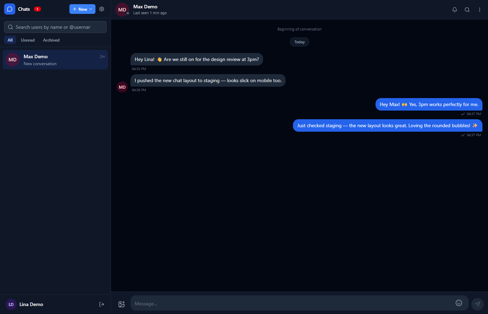
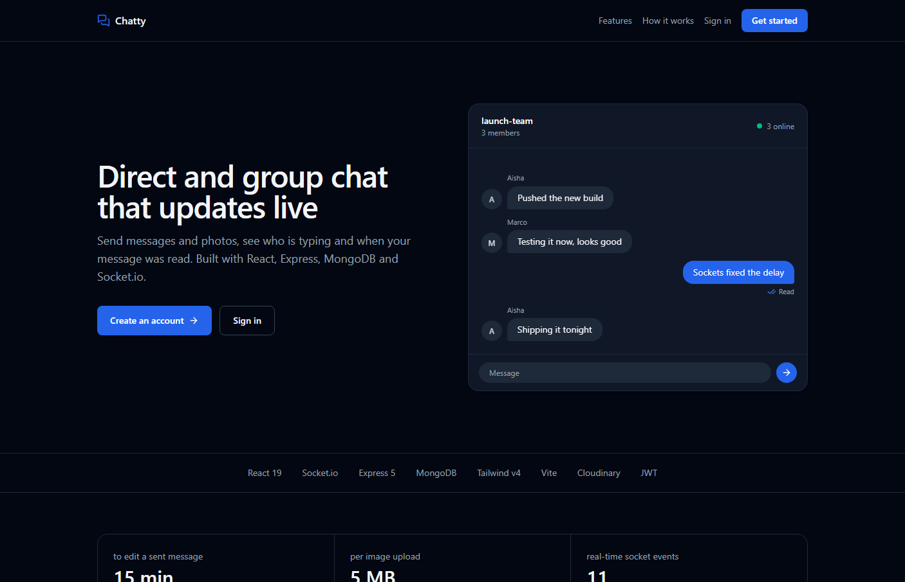
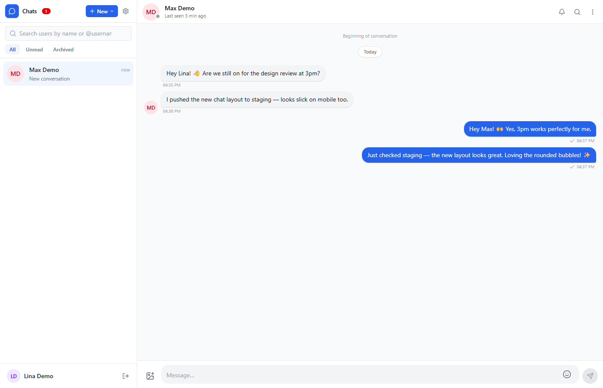
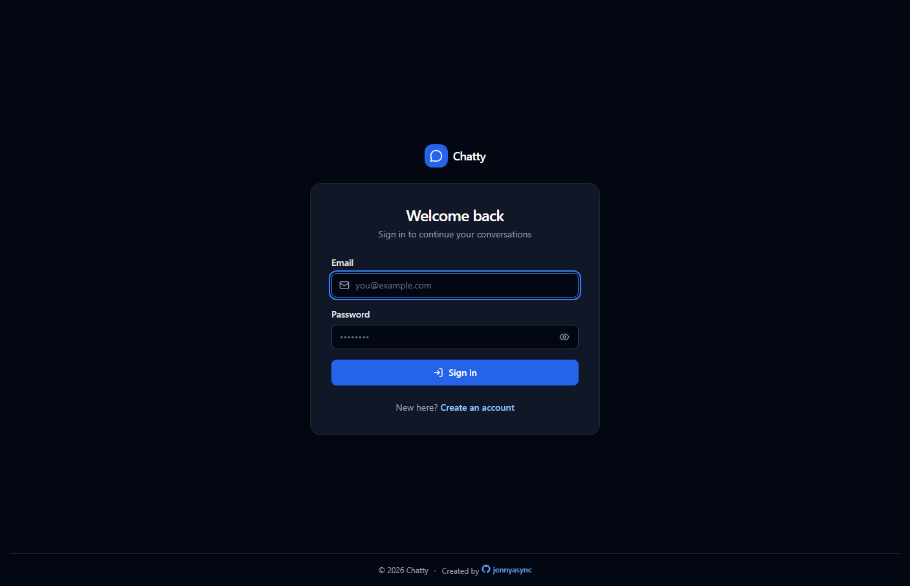
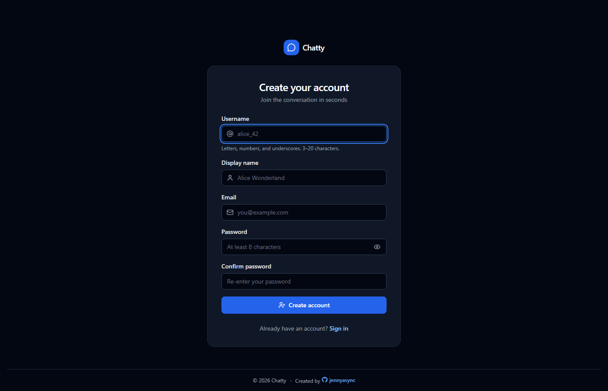
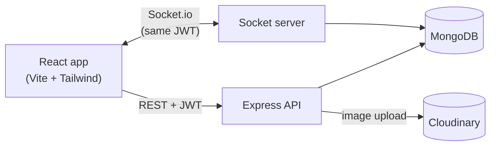
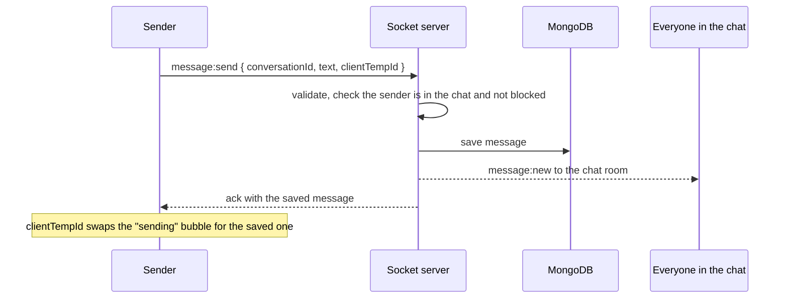

<div align="center">

# Chatty

**Direct and group chat that updates live.**
Messages, typing indicators, read receipts and images, built on the MERN stack with Socket.io.

[Live demo](https://chat-app-mernn.netlify.app) · [Screenshots](#screenshots) · [How it works](#how-it-works) · [Run it locally](#run-it-locally)

<br />



</div>

<br />

## What it does

| | |
|---|---|
| **Live messaging** | Messages arrive instantly over Socket.io, with typing indicators, online status and sent/read ticks |
| **Groups** | Create a group, add people, promote admins, rename or leave |
| **Rich messages** | Images (stored on Cloudinary), replies, reactions, edits within 15 minutes, delete for everyone |
| **Search** | Find people by name, or search inside a conversation |
| **Notifications** | In-app, browser and sound alerts, with per-chat mute |
| **Privacy** | Hide your online status or read receipts, block users, report abuse |
| **Admin panel** | Manage users, review reports, suspend accounts, and see an audit log of every admin action |
| **Themes** | Light and dark, plus font size, density and reduced-motion settings |

## Screenshots

<table>
  <tr>
    <td width="50%"></td>
    <td width="50%"></td>
  </tr>
  <tr>
    <td align="center"><sub>Landing page</sub></td>
    <td align="center"><sub>Chat in light mode</sub></td>
  </tr>
  <tr>
    <td width="50%"></td>
    <td width="50%"></td>
  </tr>
  <tr>
    <td align="center"><sub>Sign in</sub></td>
    <td align="center"><sub>Create account</sub></td>
  </tr>
</table>

## How it works



The app talks to the server in two ways:

- **REST** for anything that needs an answer: signing in, loading older messages, uploading an image.
- **Socket.io** for anything the server needs to push: new messages, typing, presence, read receipts, notifications.

### Sending a message



### Rooms

When a socket connects, the server joins it to:

- `user:<id>` for every tab and device of that user (notifications, forced logout)
- `conv:<id>` for each conversation **the database says the user belongs to**

The client never chooses its own rooms, so nobody can listen in on a chat they're not part of.

## Security

- Passwords hashed with bcrypt (cost 12). Login gives the same error for an unknown email and a wrong password
- The JWT is checked on every request and on the socket handshake. Suspended users are cut off immediately
- express-validator on every route, NoSQL-injection sanitizing, Helmet headers and a CORS allow-list
- Separate rate limits for auth, messages and uploads
- `role` and `status` can never be set from the request body

## Tech

| Frontend | Backend | Data and hosting |
|---|---|---|
| React 19, React Router | Node, Express 5 | MongoDB with Mongoose |
| Vite, Tailwind CSS v4 | Socket.io | Cloudinary for images |
| Axios, socket.io-client | JWT, bcrypt, express-validator | Netlify + Render |

## Run it locally

You need **Node 18.18+**, a **MongoDB** database (local or Atlas) and a free **Cloudinary** account for images.

```bash
git clone https://github.com/jennyasync/chat-app-mern.git
cd chat-app-mern

cp server/.env.example server/.env
cp client/.env.example client/.env
```

Fill in `server/.env`, then start both parts in two terminals:

```bash
cd server && npm install && npm run seed:admin && npm run dev   # API on http://localhost:5000
```

```bash
cd client && npm install && npm run dev                         # app on http://localhost:5173
```

<details>
<summary><b>Environment variables</b></summary>
<br />

**server/.env**

| Variable | Example | Notes |
|---|---|---|
| `PORT` | `5000` | |
| `CLIENT_URL` | `http://localhost:5173` | Allowed CORS origin |
| `MONGO_URI` | `mongodb://localhost:27017/chat_app` | |
| `JWT_SECRET` | 64 random hex characters | `node -e "console.log(require('crypto').randomBytes(32).toString('hex'))"` |
| `JWT_EXPIRES_IN` | `7d` | |
| `CLOUDINARY_CLOUD_NAME` / `_API_KEY` / `_API_SECRET` | | From your Cloudinary dashboard |
| `ADMIN_EMAIL` / `ADMIN_USERNAME` / `ADMIN_PASSWORD` | | Used by `npm run seed:admin` |
| `MAX_UPLOAD_SIZE_MB` | `5` | |

**client/.env**

| Variable | Example |
|---|---|
| `VITE_API_URL` | `http://localhost:5000/api` |
| `VITE_SOCKET_URL` | `http://localhost:5000` |

</details>

<details>
<summary><b>Project structure</b></summary>
<br />

```
server/
  index.js        Express app, middleware, routes, Socket.io setup
  config/         env loading, database, Cloudinary
  models/         User, Conversation, Message, Notification, Report, AdminAuditLog
  routes/         URL -> validator -> controller
  controllers/    REST handlers
  sockets/        message, typing, presence and group events
  utils/          rules shared by REST and sockets
  middlewares/    auth, errors, uploads, rate limits
client/src/
  api/            Axios instance, one file per resource
  contexts/       Auth, Socket, ChatState, Notifications, Preferences
  pages/          landing, auth, chat, profile, settings, admin
  components/     chat UI, layout, modals, shared pieces
  hooks/          small reusable hooks
```

</details>

<br />

<div align="center">
<sub>Built by <a href="https://github.com/jennyasync">jennyasync</a> · MIT license</sub>
</div>
