<div align="center">

<a href="https://chat-app-mernn.netlify.app/">
  
</a>

<br />

<a href="https://chat-app-mernn.netlify.app/">
  
</a>

<p>
  <a href="https://chat-app-mernn.netlify.app/"></a>
  <a href="https://chat-app-mern-dm8x.onrender.com/api-docs"></a>
  <a href="LICENSE"></a>
</p>

<p>
  
  
  
  
  
  
  
  
</p>

<p>
  <a href="#-features">Features</a> &nbsp;|&nbsp;
  <a href="#-quick-start">Quick start</a> &nbsp;|&nbsp;
  <a href="#-architecture">Architecture</a> &nbsp;|&nbsp;
  <a href="#-api-reference">API</a> &nbsp;|&nbsp;
  <a href="#-security">Security</a> &nbsp;|&nbsp;
  <a href="#-deployment">Deploy</a> &nbsp;|&nbsp;
  <a href="#-roadmap">Roadmap</a>
</p>

<a href="https://chat-app-mernn.netlify.app/">
  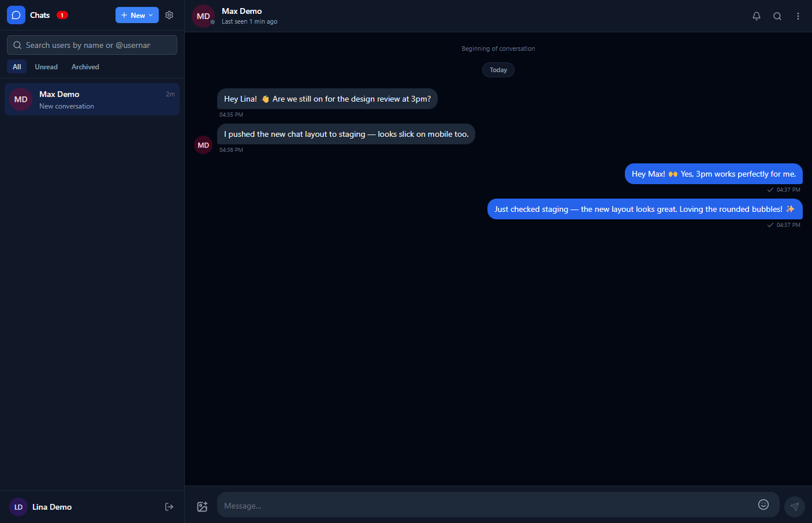
</a>

</div>

<br />

## 💬 About

**Chatty** is a full-stack, real-time chat application built on **MongoDB, Express 5, React 19 and Node.js**, with **Socket.io** for live events. It covers the things a real messenger needs beyond "send a message": presence, typing indicators, read receipts, reactions, edits with time windows, group admin roles, privacy toggles, reporting and a full admin moderation dashboard.

> [!TIP]
> The backend runs on Render's free tier, so the **first request can take 30–60 seconds** while the server wakes up. After that, everything is instant.

<br />

## ✨ Features

<table>
  <tr>
    <td width="50%" valign="top">

### ⚡ Real-time core
- 1-1 and group messaging over Socket.io
- Online/offline presence (with opt-out)
- Typing indicators that auto-expire after 5 s
- Read receipts: ✓ delivered, ✓✓ read
- Browser notifications and sound, muted for the open chat

    </td>
    <td width="50%" valign="top">

### 💬 Messaging
- Image messages via Cloudinary (JPEG/PNG/WebP, 5 MB)
- Emoji reactions, deduplicated server-side
- Replies, edit within 15 min, delete for everyone within 5 min
- Full-text search inside a conversation
- Cursor-based infinite scroll for history

    </td>
  </tr>
  <tr>
    <td width="50%" valign="top">

### 👥 People & groups
- User search, block, mute and archive
- Group admins, rename, add/remove members
- Last-admin protection so a group is never orphaned
- Public profiles with avatar and bio

    </td>
    <td width="50%" valign="top">

### 🛡️ Safety & control
- Report users, messages or conversations
- Admin dashboard: stats, users, reports, audit log
- Suspending a user force-disconnects their sockets
- Light/dark theme, font size, density, reduced motion

    </td>
  </tr>
</table>

<br />

## 📸 Screenshots

<div align="center">

| Landing | Chat (dark) | Chat (light) |
| :---: | :---: | :---: |
| 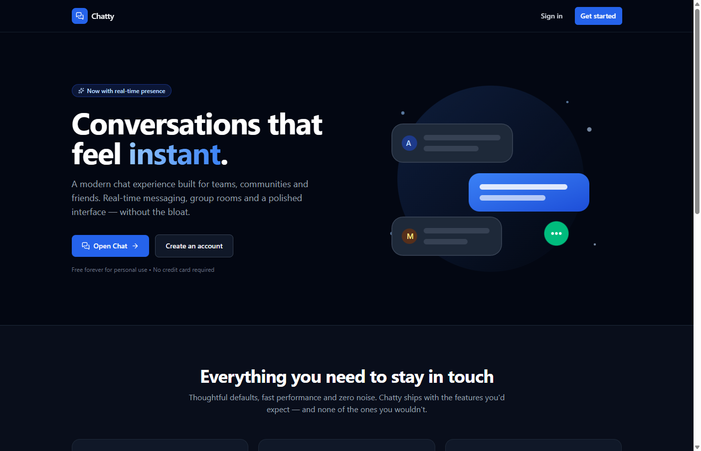 |  | 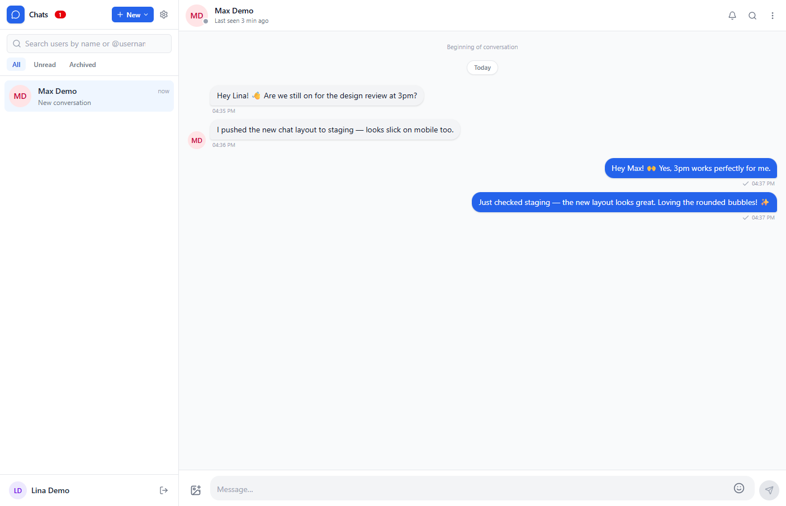 |
| **Login** | **Register** | **Profile** |
| 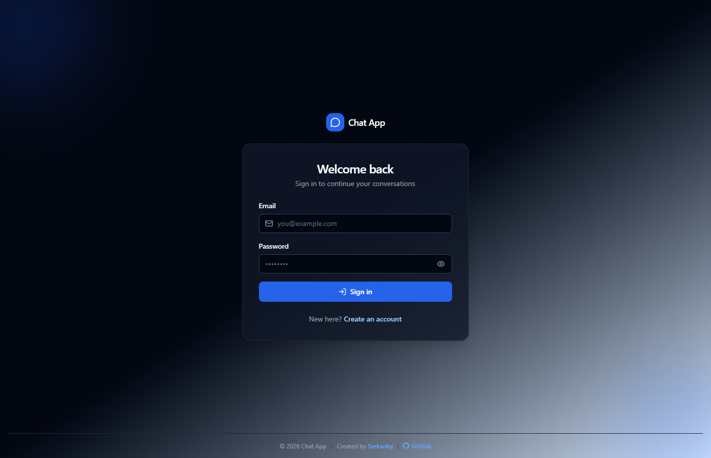 | 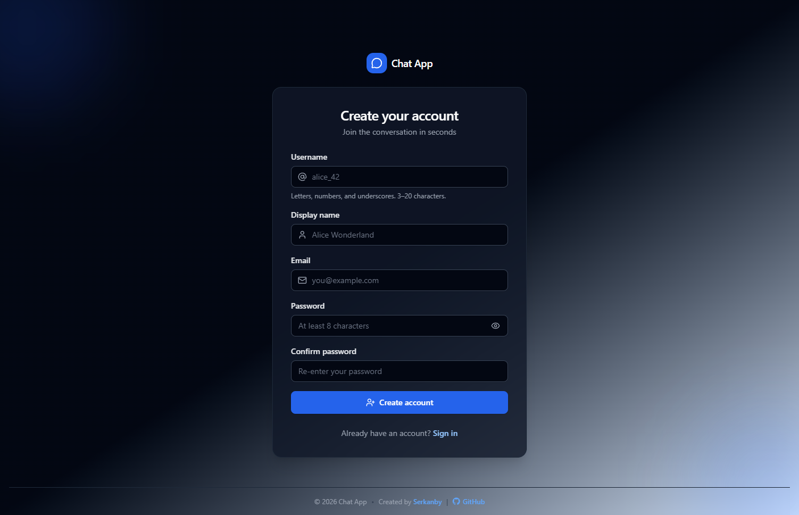 | 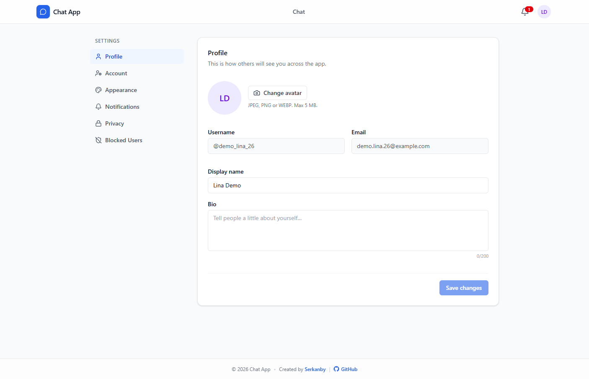 |
| **Appearance** | **Privacy** | **Notifications** |
| 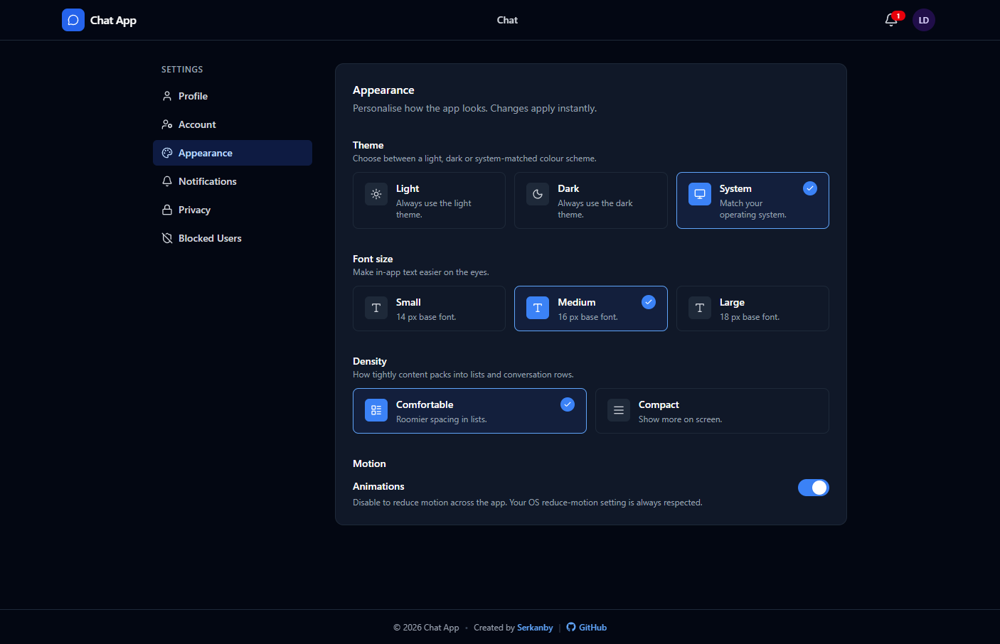 | 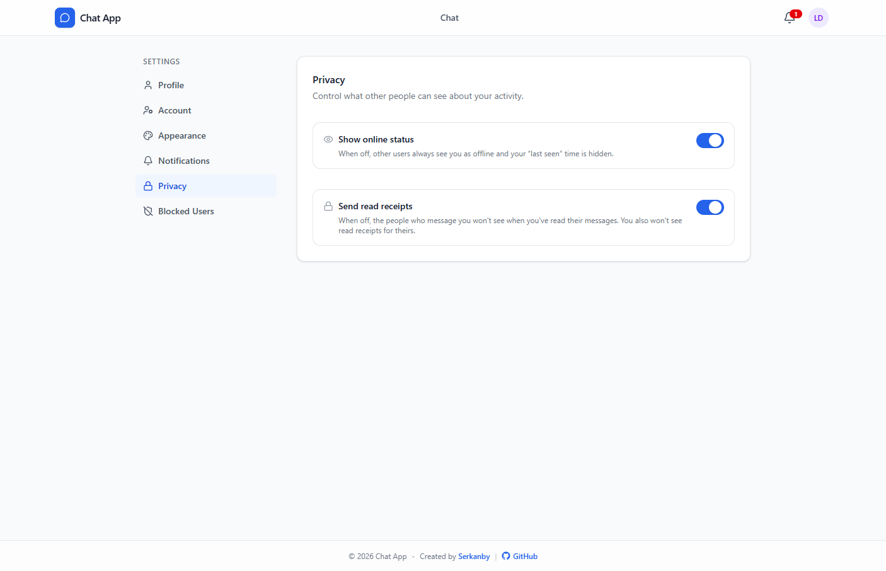 | 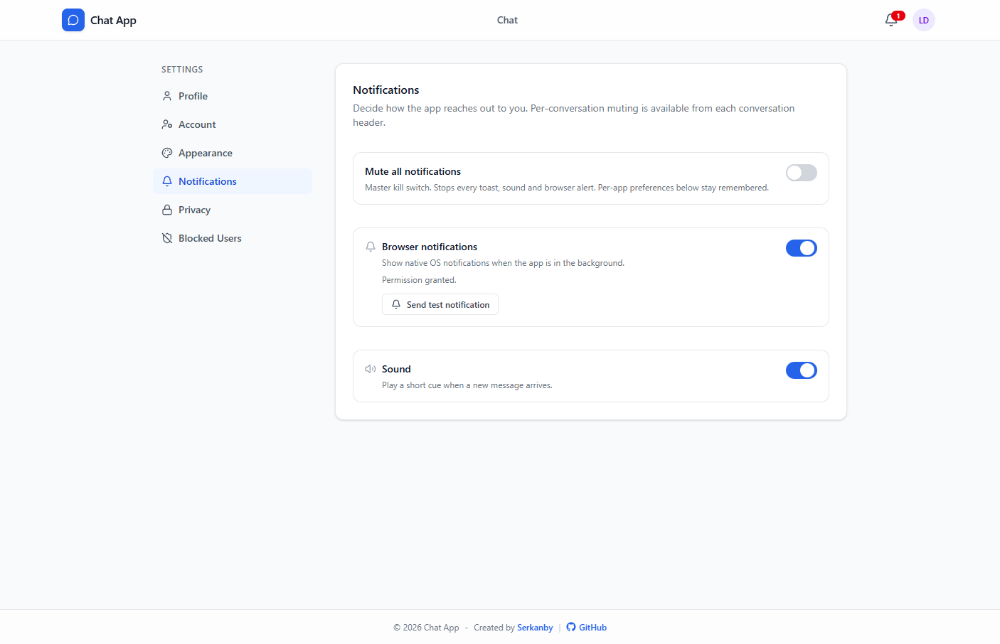 |

</div>

<br />

## 🧰 Tech stack

<div align="center">
  
</div>

<br />

| Layer | Tools |
| --- | --- |
| **Frontend** | React 19, Vite 8, React Router 7, Tailwind CSS 4, Socket.io Client, Axios, Lucide, React Hot Toast, Emoji Picker React |
| **Backend** | Node.js 18+ (ESM), Express 5, Socket.io 4, Mongoose 9, JWT, bcryptjs, Multer, Cloudinary |
| **Security** | Helmet, express-rate-limit, express-validator, express-mongo-sanitize, CORS allow-list |
| **Docs & ops** | swagger-jsdoc, swagger-ui-express, morgan, compression, Render, Netlify |

<br />

## 🚀 Quick start

> **You need:** Node.js 18.18+, a MongoDB connection string ([Atlas free tier](https://www.mongodb.com/atlas) works) and a free [Cloudinary](https://cloudinary.com/) account.

```bash
# 1. Clone
git clone https://github.com/jennyasync/chat-app-mern.git
cd chat-app-mern

# 2. Create env files
cp server/.env.example server/.env
cp client/.env.example client/.env

# 3. Install
cd server && npm install && cd ../client && npm install && cd ..

# 4. Seed the first admin (safe to run more than once)
cd server && npm run seed:admin

# 5. Run (two terminals)
npm run dev                 # server → http://localhost:5000
cd ../client && npm run dev # client → http://localhost:5173
```

Open **http://localhost:5173**. Swagger docs live at **http://localhost:5000/api-docs** and the health check at **/api/health**.

<details>
<summary><b>🔑 Environment variables</b></summary>
<br />

**`server/.env`**

| Variable | Example | Notes |
| --- | --- | --- |
| `NODE_ENV` | `development` | |
| `PORT` | `5000` | |
| `CLIENT_URL` | `http://localhost:5173` | Used for the CORS allow-list |
| `MONGO_URI` | `mongodb+srv://...` | |
| `JWT_SECRET` | 32+ random chars | Rejected at startup if too short |
| `JWT_EXPIRES_IN` | `7d` | |
| `CLOUDINARY_CLOUD_NAME` | | From the Cloudinary dashboard |
| `CLOUDINARY_API_KEY` | | |
| `CLOUDINARY_API_SECRET` | | |
| `ADMIN_EMAIL` | `admin@example.com` | Used by `seed:admin` |
| `ADMIN_USERNAME` | `admin` | |
| `ADMIN_PASSWORD` | | Use a strong one |
| `MAX_UPLOAD_SIZE_MB` | `5` | |

**`client/.env`**

| Variable | Example |
| --- | --- |
| `VITE_API_URL` | `http://localhost:5000/api` |
| `VITE_SOCKET_URL` | `http://localhost:5000` |

Generate a strong secret:

```bash
node -e "console.log(require('crypto').randomBytes(32).toString('hex'))"
```

</details>

<details>
<summary><b>🧭 Using the app</b></summary>
<br />

1. **Register** with a unique username, email and strong password.
2. **Search** for people in the sidebar to start a direct chat.
3. **Create a group** from the new-chat modal and pick admins.
4. **Send** text (up to 4000 chars), images (up to 5 MB), replies and reactions.
5. **Edit** your message within 15 minutes, or **delete for everyone** within 5.
6. **Mute**, **archive** or **block** from the conversation menu or privacy settings.
7. **Customize** theme, font size, density and motion in Settings.
8. **Admins** open `/admin` to manage users, resolve reports and audit conversations.

</details>

<br />

## 🏗️ Architecture

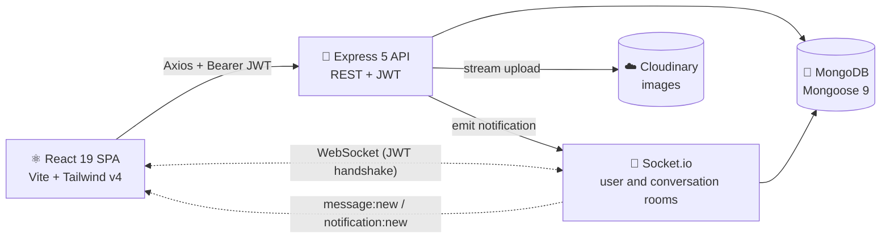

<details>
<summary><b>🗂️ Domain model</b></summary>
<br />

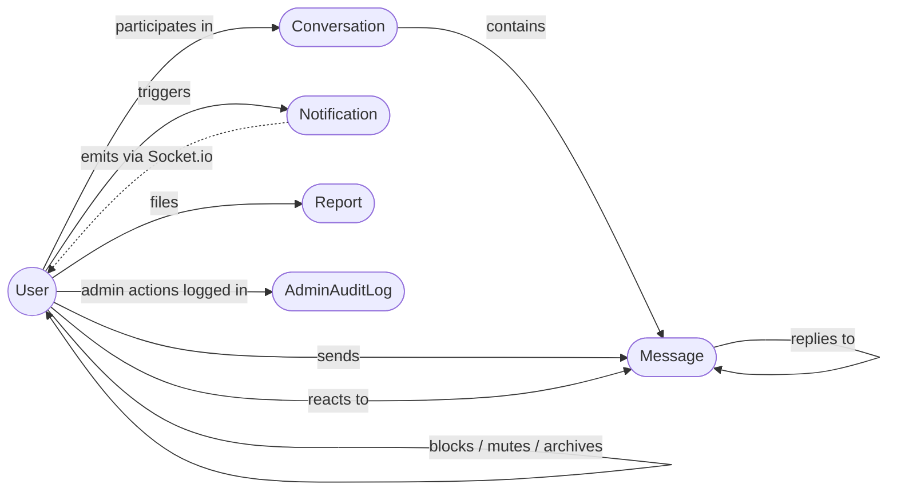

</details>

<details>
<summary><b>🔐 How authentication works</b></summary>
<br />

1. The client posts credentials to `/api/auth/register` or `/api/auth/login`.
2. The server validates input, checks the bcrypt hash and signs a JWT with the user's `id` and `role`.
3. The token is stored in `localStorage`; an Axios interceptor sends it as `Authorization: Bearer <token>`.
4. The `protect` middleware verifies the JWT and **re-fetches the user on every request**, so suspended users are blocked instantly.
5. The same `socketAuthMiddleware` runs on the Socket.io handshake, so HTTP and WebSocket share one identity.

```js
api.interceptors.request.use((config) => {
  const token = localStorage.getItem('token');
  if (token) config.headers.Authorization = `Bearer ${token}`;
  return config;
});
```

</details>

<details>
<summary><b>🔌 How real-time delivery works</b></summary>
<br />

- Express and Socket.io share **one HTTP server, one port and one CORS policy**.
- The server alone decides room membership. `socket.join` / `socket.leave` never run on raw client input; every join follows a database participant check.
- Every user has a personal room `user:<id>` for notifications, invites and force-disconnects.
- Every conversation has a room `conv:<id>`, joined only by verified participants.
- **HTTP** handles request/response work (auth, history, uploads, admin). **WebSocket** handles server push (messages, presence, typing, receipts, group changes).

</details>

<details>
<summary><b>🖼️ How image uploads work</b></summary>
<br />

1. The client posts the file to `/api/upload/message-image` as `multipart/form-data`.
2. Multer holds it in memory while the middleware checks the MIME type and 5 MB cap.
3. The server uploads to Cloudinary with a server-generated `publicId`.
4. The Cloudinary URL comes back and is sent with the next `message:send` event.
5. Messages only accept image URLs from the configured Cloudinary host, so no arbitrary embeds.

</details>

<br />

## 📡 API reference

> **Base URL:** `https://chat-app-mern-dm8x.onrender.com/api` (prod) or `http://localhost:5000/api` (dev).
> Authenticated routes need `Authorization: Bearer <jwt>`. Try every endpoint in the **[Swagger UI](https://chat-app-mern-dm8x.onrender.com/api-docs)** or grab the **[raw OpenAPI spec](https://chat-app-mern-dm8x.onrender.com/api-docs.json)**.

<details>
<summary><b>Auth</b> · 6 endpoints</summary>

| Method | Endpoint | Auth | Description |
| --- | --- | --- | --- |
| POST | `/auth/register` | – | Create a user (rate-limited) |
| POST | `/auth/login` | – | Get a JWT (rate-limited) |
| GET | `/auth/me` | ✅ | Current profile and preferences |
| PATCH | `/auth/profile` | ✅ | Update `displayName`, `bio`, `avatarUrl` |
| PATCH | `/auth/password` | ✅ | Change password |
| DELETE | `/auth/account` | ✅ | Anonymize messages and leave conversations |

</details>

<details>
<summary><b>Users</b> · 6 endpoints</summary>

| Method | Endpoint | Description |
| --- | --- | --- |
| GET | `/users/search?q=` | Prefix search by username or display name |
| GET | `/users/me/blocked` | Users you have blocked |
| PATCH | `/users/me/preferences` | Theme, density, privacy, notifications |
| POST | `/users/:userId/block` | Block a user |
| DELETE | `/users/:userId/block` | Unblock a user |
| GET | `/users/:username` | Public profile |

</details>

<details>
<summary><b>Conversations</b> · 14 endpoints</summary>

| Method | Endpoint | Description |
| --- | --- | --- |
| GET | `/conversations` | Paginated list (`page`, `limit`, `archived`) |
| GET | `/conversations/unread-summary` | Unread count per conversation |
| POST | `/conversations/direct` | Find or create a 1-1 chat |
| POST | `/conversations/group` | Create a group |
| GET | `/conversations/:id` | Conversation detail |
| PATCH | `/conversations/:id` | Rename or change avatar (group admin) |
| DELETE | `/conversations/:id` | Leave or delete |
| POST | `/conversations/:id/members` | Add members (group admin) |
| DELETE | `/conversations/:id/members/:userId` | Remove a member (group admin) |
| POST | `/conversations/:id/admins/:userId` | Promote to admin |
| DELETE | `/conversations/:id/admins/:userId` | Demote admin (last-admin protected) |
| POST | `/conversations/:id/mute` | Toggle mute |
| POST | `/conversations/:id/archive` | Toggle archive |
| POST | `/conversations/:id/read` | Mark as read |

</details>

<details>
<summary><b>Messages</b> · 6 endpoints</summary>

| Method | Endpoint | Description |
| --- | --- | --- |
| GET | `/conversations/:id/messages` | History, cursor via `?before=<msgId>` |
| POST | `/conversations/:id/messages` | Send (rate-limited) |
| GET | `/conversations/:id/messages/search?q=` | Search inside a conversation |
| PATCH | `/messages/:id` | Edit own message (≤ 15 min) |
| DELETE | `/messages/:id` | Delete for me (any time) or everyone (≤ 5 min) |
| POST | `/messages/:id/reactions` | Toggle a reaction `{ emoji }` |

</details>

<details>
<summary><b>Uploads, notifications & reports</b> · 8 endpoints</summary>

| Method | Endpoint | Description |
| --- | --- | --- |
| POST | `/upload/avatar` | `multipart/form-data`, field `file`, ≤ 5 MB |
| POST | `/upload/message-image` | Same rules, returns the Cloudinary URL |
| GET | `/notifications` | Paginated list |
| GET | `/notifications/unread-count` | Badge count |
| PATCH | `/notifications/read-all` | Mark all read |
| PATCH | `/notifications/:id/read` | Mark one read |
| DELETE | `/notifications/:id` | Dismiss |
| POST | `/reports` | Report a user, message or conversation |

</details>

<details>
<summary><b>Admin</b> · 11 endpoints (role <code>admin</code>)</summary>

| Method | Endpoint | Description |
| --- | --- | --- |
| GET | `/admin/stats` | Users, online, conversations and more |
| GET | `/admin/users` | List and filter users |
| GET | `/admin/users/:id` | User detail |
| PATCH | `/admin/users/:id/status` | `active` / `suspended` (audit-logged) |
| PATCH | `/admin/users/:id/role` | `user` / `admin` (last-admin protected) |
| DELETE | `/admin/users/:id` | Hard delete with cascade cleanup |
| GET | `/admin/reports` | Moderation queue |
| GET | `/admin/reports/:id` | Report with target preview |
| PATCH | `/admin/reports/:id` | Resolve or dismiss with `reviewNote` |
| DELETE | `/admin/messages/:id` | Force delete, emits `message:deleted` |
| GET | `/admin/conversations/:id/messages` | Audit any conversation |

</details>

<details>
<summary><b>Socket.io events</b> · client ⇄ server</summary>

**Client → server**

| Event | Payload | Purpose |
| --- | --- | --- |
| `message:send` | `{ conversationId, type, text?, imageUrl?, replyTo? }` | Save and broadcast |
| `message:edit` | `{ messageId, text }` | Sender only, ≤ 15 min |
| `message:delete` | `{ messageId, scope }` | `me` or `everyone` (≤ 5 min) |
| `message:reaction` | `{ messageId, emoji }` | Toggle reaction |
| `conversation:read` | `{ conversationId, lastReadMessageId? }` | Update read position |
| `conversation:open` / `close` | `{ conversationId }` | Pause / resume notifications |
| `typing:start` / `stop` | `{ conversationId }` | Typing indicator |
| `presence:list` | `{ userIds }` | Presence snapshot |

**Server → client**

| Event | Purpose |
| --- | --- |
| `message:new`, `message:edited`, `message:deleted` | Message lifecycle |
| `message:reactionUpdated` | Aggregated reactions |
| `conversation:readBy` | Powers ✓✓ ticks |
| `userOnline` / `userOffline` | Privacy-aware presence |
| `typing:start` / `typing:stop` | Other participants typing |
| `notification:new` | Sent to `user:<id>` |
| `group:created`, `group:updated`, `group:adminChanged` | Group metadata |
| `group:memberAdded`, `group:memberRemoved`, `group:youWereRemoved` | Membership |
| `server:error` | Connection setup failure |

</details>

<br />

## 🛡️ Security

Security is layered so no single check is the only thing standing in the way.

| Area | What's in place |
| --- | --- |
| **HTTP** | Helmet headers, `x-powered-by` off, gzip, 100 kb body limit, strict CORS allow-list |
| **Auth** | bcrypt (cost 12), Bearer-only JWT, minimum secret length enforced, generic login errors to stop user enumeration |
| **Input** | `express-validator` on every route, NoSQL sanitizer (Express 5 safe), ObjectId checks, ReDoS-safe search |
| **Authorization** | Participant, group-admin and ownership guards on every write; no mass assignment of `role`, `status`, `email` |
| **Rate limits** | Separate buckets for global, auth, messages, uploads and admin |
| **Sockets** | Same JWT middleware as HTTP, 1 MB buffer cap, server-only room joins, instant disconnect on suspension |
| **Uploads** | MIME allow-list, 5 MB cap, in-memory storage, server-generated IDs, CDN host check |
| **Privacy** | Online status and read receipts enforced server-side |
| **Moderation** | Write-only admin audit log, 24 h report cooldown, admins can't suspend themselves or other admins |
| **Errors** | Production responses return only `{ success, message }`; no stack traces |

Found a vulnerability? Please follow the [security policy](.github/SECURITY.md) instead of opening a public issue.

<br />

## 📁 Project structure

<details>
<summary><b>Show the folder tree</b></summary>

```text
chat-app-mern/
├── client/                  React 19 + Vite SPA
│   ├── public/              favicon, notification sound, _redirects
│   └── src/
│       ├── api/             Axios instance + service wrappers
│       ├── components/      admin, chat, common, guards, layout, modals
│       ├── contexts/        Auth, Socket, ChatState, Preferences, Notifications
│       ├── hooks/           useDebounce, useInfiniteScroll, useScrollToBottom
│       ├── layouts/         Auth, Main, Chat, Settings, Admin shells
│       ├── pages/           auth, chat, admin, settings, landing
│       ├── utils/           formatDate, notify, sound, constants
│       ├── App.jsx          routes + providers
│       └── index.css        Tailwind v4 theme tokens
├── server/                  Express 5 + Socket.io API
│   ├── config/              env validation, db, socket, cloudinary
│   ├── controllers/         thin HTTP handlers
│   ├── middlewares/         auth, role, validate, sanitize, rate limits, upload, errors
│   ├── models/              User, Conversation, Message, Notification, Report, AdminAuditLog
│   ├── routes/              one file per resource
│   ├── scripts/             seedAdmin.js
│   ├── sockets/             auth, presence, typing, message, group, rooms
│   ├── utils/               services, serializers, apiError, escapeRegex
│   ├── validators/          express-validator chains
│   └── index.js             HTTP + Socket.io on one port
├── assets/screenshots/      images used in this README
├── docs/build-guide.md      step-by-step build playbook
├── .github/                 issue/PR templates, contributing, security, code of conduct
└── render.yaml              Render blueprint
```

</details>

<br />

## ☁️ Deployment

<table>
  <tr>
    <td width="50%" valign="top">

### Backend on Render
1. New **Web Service**, connect this repo (or use the included `render.yaml`).
2. Root directory `server`, build `npm install`, start `npm start`.
3. Add the server env vars, with `NODE_ENV=production` and `CLIENT_URL` set to your Netlify URL.
4. Run `npm run seed:admin` once from the Render shell.

    </td>
    <td width="50%" valign="top">

### Frontend on Netlify
1. New site from this repo.
2. Base `client`, build `npm run build`, publish `client/dist`.
3. Set `VITE_API_URL` and `VITE_SOCKET_URL` to your Render URL.
4. SPA fallback is handled by `client/public/_redirects`.

    </td>
  </tr>
</table>

| Service | URL |
| --- | --- |
| 🌐 Frontend | https://chat-app-mernn.netlify.app/ |
| 🚂 API | https://chat-app-mern-dm8x.onrender.com/ |
| 📘 Swagger | https://chat-app-mern-dm8x.onrender.com/api-docs |
| ❤️ Health | https://chat-app-mern-dm8x.onrender.com/api/health |

<br />

## 🩺 Troubleshooting

<details>
<summary><b>The app is stuck loading on first visit</b></summary>
<br />
The Render free tier sleeps after inactivity. Open the <a href="https://chat-app-mern-dm8x.onrender.com/api/health">health check</a>, wait for it to respond, then reload the app.
</details>

<details>
<summary><b>CORS error in the browser console</b></summary>
<br />
<code>CLIENT_URL</code> on the server must exactly match the frontend origin, including protocol and without a trailing slash.
</details>

<details>
<summary><b>Messages send but don't appear live</b></summary>
<br />
Check that <code>VITE_SOCKET_URL</code> points to the server root (no <code>/api</code>) and that the token is present in <code>localStorage</code>.
</details>

<details>
<summary><b>Image upload fails</b></summary>
<br />
Confirm the three Cloudinary variables are set and the file is JPEG, PNG or WebP under 5 MB.
</details>

<br />

## 🗺️ Roadmap

- [x] JWT auth, real-time 1-1 and group chat
- [x] Presence, typing indicators, read receipts
- [x] Images, reactions, replies, edit and delete windows
- [x] Block, mute, archive, reporting and admin moderation
- [x] Themes and accessibility preferences
- [x] Swagger docs, Render + Netlify deployment
- [ ] Voice and video calls (WebRTC)
- [ ] Voice messages
- [ ] End-to-end encryption for direct chats
- [ ] File attachments (PDF, audio, video)
- [ ] Message forwarding and pinning
- [ ] Web Push / FCM notifications
- [ ] Internationalization (i18n)

<br />

## 🤝 Contributing

Contributions are welcome. Please read the [contributing guide](.github/CONTRIBUTING.md) and [code of conduct](.github/CODE_OF_CONDUCT.md) first.

```bash
git checkout -b feat/your-feature
git commit -m "feat: add your feature"
git push origin feat/your-feature
# then open a pull request
```

Commit prefixes: `feat:` new feature, `fix:` bug fix, `refactor:` restructure, `docs:` documentation, `chore:` maintenance.

<br />

## 🙏 Acknowledgments

[React](https://react.dev/) · [Vite](https://vitejs.dev/) · [Tailwind CSS](https://tailwindcss.com/) · [Express](https://expressjs.com/) · [MongoDB](https://www.mongodb.com/) · [Mongoose](https://mongoosejs.com/) · [Socket.io](https://socket.io/) · [Cloudinary](https://cloudinary.com/) · [Lucide](https://lucide.dev/) · [React Hot Toast](https://react-hot-toast.com/) · [Render](https://render.com/) · [Netlify](https://www.netlify.com/)

<br />

<div align="center">

### 👩‍💻 Built by [@jennyasync](https://github.com/jennyasync)

📧 shwetasing09kj@gmail.com &nbsp;|&nbsp; 🐛 [Report a bug](https://github.com/jennyasync/chat-app-mern/issues) &nbsp;|&nbsp; ⚖️ [MIT License](LICENSE)

<br />

**If Chatty helped you learn something, a ⭐ helps others find it.**


</div>
